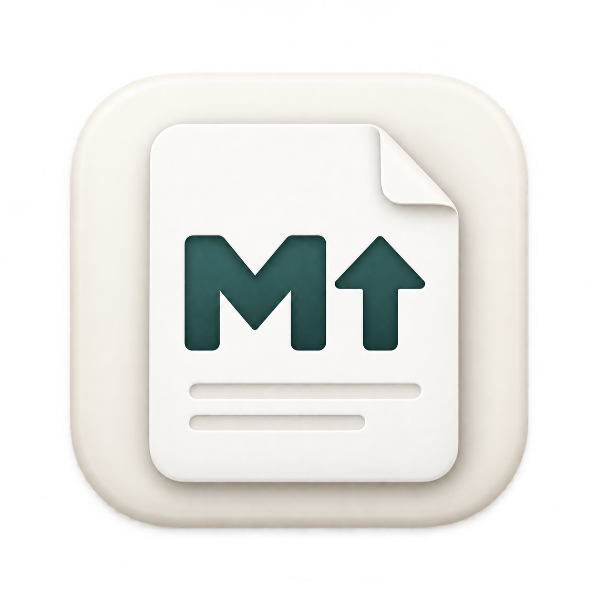
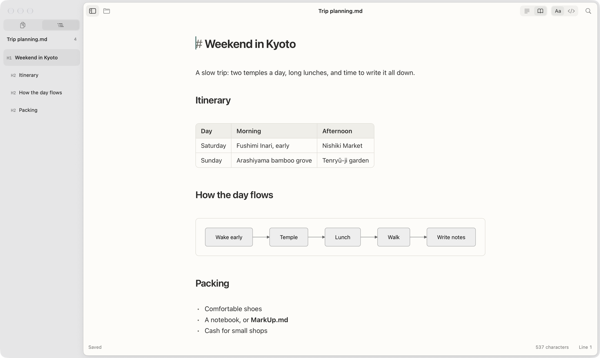

<p align="center">
  
</p>

<h1 align="center">MarkUp.md</h1>

<p align="center">
  A calm, local Markdown editor for your Mac.<br>
  Write in plain text and watch it turn into clean formatting as you go.
</p>

<p align="center">
  <a href="https://github.com/xonwun/MarkUp/releases/latest"><strong>Download for macOS</strong></a>
  · macOS 14 or later · Apple silicon and Intel
</p>

<p align="center">
  
</p>

## Why MarkUp.md

Most Markdown apps make you choose between a raw text editor and a preview pane. MarkUp.md gives you one page: the line you're editing shows its Markdown, and everything else looks finished. Your files are ordinary `.md` files on your Mac, with no account, cloud service, or library to import into.

- **Formatting in place.** Headings, bold, lists, links and code look right as soon as you move off the line. Press ⇧⌘M any time to see the raw source.
- **Tables and diagrams.** Markdown tables and [Mermaid](https://mermaid.js.org) diagrams render right in the document. Click one to edit its source.
- **Your files, where you keep them.** Open any `.md` file from Finder. Recent files stay in the sidebar, and you can pin the ones you use most and drag to arrange them.
- **Two ways to write.** *Compact* for working notes, *Reading* for a centered, book-like column. Switch from the toolbar, next to the Formatted/Source switch.
- **Find your place.** The Outline tab lists every heading so you can jump around long documents.
- **Careful with your work.** MarkUp.md reminds you about unsaved changes, saves safely, and warns you if another app changed the file.
- **Feels like a Mac app.** A glass window with the page floating on it, light and dark mode, keyboard shortcuts, and English or Simplified Chinese.

<p align="center">
  
</p>

**A gentle start.** The first time you open MarkUp.md, a welcome screen greets you and then clears to open a short guide, Welcome.md. Small tips point out the sidebar, outline, layout, source, and find the first time you reach each one, and you can turn them off at any time.

## Install

1. Download the **.dmg** from the [latest release](https://github.com/xonwun/MarkUp/releases/latest).
2. Open it and drag the app into **Applications**.
3. Open it.

**The first time you open it,** macOS may say it can't verify the developer. MarkUp.md is a free, open-source app that isn’t notarized by Apple yet. To open it anyway:

- Open **System Settings → Privacy & Security**, scroll down, and click **Open Anyway** next to the MarkUp.md message. You only need to do this once.

Prefer a zip? There's one on the same release page.

## Keyboard shortcuts

| Action | Shortcut |
| --- | --- |
| New / Open / Save | ⌘N / ⌘O / ⌘S |
| Save As | ⇧⌘S |
| Find | ⌘F |
| Undo / Redo | ⌘Z / ⇧⌘Z |
| Bold / Italic | ⌘B / ⌘I |
| Show or hide the sidebar | ⌃⌘S |
| Show Markdown source | ⇧⌘M |

## Good to know

- There's no autosave. Press ⌘S to save.
- Tables are edited as Markdown text; there's no spreadsheet-style table editor.
- Not included yet: images in the document, math, folders, multiple tabs, and sync.

## Build from source

Requires macOS 14+, Swift 6 (Xcode or the Command Line Tools), and Node.js 22+.

```sh
npm ci
./scripts/build-app.sh      # builds dist/MarkUp.md.app (universal)
./scripts/package.sh        # also makes dist/MarkUp.md-<version>.dmg and .zip
```

Local builds are ad-hoc signed and not notarized.

Built with SwiftUI, AppKit, WKWebView, ProseMirror, markdown-it, and Mermaid.

- `Sources/MarkUp/` — the native app: window, toolbar, sidebar
- `Editor/` — the editor (ProseMirror) and its styles
- `Assets/` — app icon
- `Tests/` — editor tests (`npm test`) and native smoke tests

More detail: [architecture](docs/Architecture.md), [design decisions](docs/Design-decisions.md), [testing](docs/Testing.md), and the [changelog](docs/CHANGELOG.md).

## License

MarkUp.md is open source under the [MIT License](LICENSE).
